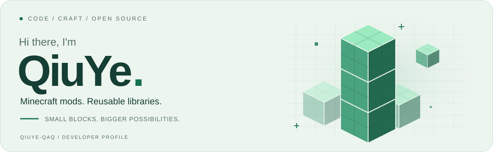

<picture>
  <source media="(prefers-color-scheme: dark)" srcset="assets/profile/hero-dark.svg" />
  <source media="(prefers-color-scheme: light)" srcset="assets/profile/hero-light.svg" />
  
</picture>

  <a href="#tech-stack">技术栈</a> &nbsp; / &nbsp;
  <a href="#projects">开源项目</a> &nbsp; / &nbsp;
  <a href="https://github.com/ModularMCLib">ModularMCLib ↗</a>

  <b>为 Minecraft 生态构建模组、工具与基础库。</b> 
  Building mods, libraries, and the connections between them.

我主要参与 Minecraft 模组与基础设施开发，关注注册系统、数据同步、模组架构与可复用 API。这里记录我的开源项目，以及把想法一点点变成代码的过程。

## 🧩 技术栈 · Tech stack

  
  
  
  
  

  
  
  

## 📦 开源项目 · Open source

从游戏内容到开发基础设施，每一个项目都是一次探索。

<!-- PROJECTS:START -->
<table>
<tr>
<td width="50%" valign="top">
<h3><a href="https://github.com/ModularMCLib/DataEnergistics">DataEnergistics</a></h3>

Minecraft 模组开发，探索数据与自动化的更多可能。

<code>Minecraft</code> &nbsp; <code>Mod development</code>

  
  
  

</td>
<td width="50%" valign="top">
<h3><a href="https://github.com/ModularMCLib/Registrate-Lib">Registrate-Lib</a></h3>

让模组对象的注册更简洁，让内容组织更清晰。

<code>Registry</code> &nbsp; <code>Developer tools</code>

  
  
  

</td>
</tr>
<tr>
<td width="50%" valign="top">
<h3><a href="https://github.com/ModularMCLib/SyncedData-Lib">SyncedData-Lib</a></h3>

面向模组开发的数据同步基础设施。

<code>Data sync</code> &nbsp; <code>Infrastructure</code>

  
  
  

</td>
<td width="50%" valign="top">
<h3><a href="https://github.com/ModularMCLib/Bigmath-FFM">Bigmath-FFM</a></h3>

基于 GMP / MPFR 与 Java FFM 的高性能大数计算库。

<code>Java FFM</code> &nbsp; <code>GMP / MPFR</code>

  
  
  

</td>
</tr>
<tr>
<td width="50%" valign="top">
<h3><a href="https://github.com/QiuYe-QAQ/GregTech-MoreMachine">GregTech-MoreMachine</a></h3>

为 GregTech Modern 社区带来更多机器与内容。

<code>GregTech</code> &nbsp; <code>Minecraft</code>

  
  
  

</td>
<td width="50%" valign="top">
<h3><a href="https://github.com/QiuYe-QAQ?tab=repositories">More to explore ↗</a></h3>

还有一些正在生长的想法，欢迎去仓库里看看。

<code>Open source</code> &nbsp; <code>Keep building</code>

</td>
</tr>
</table>
<!-- PROJECTS:END -->

---

  <b>Small blocks. Bigger possibilities.</b> 
  用代码连接灵感，用开源分享创造。

